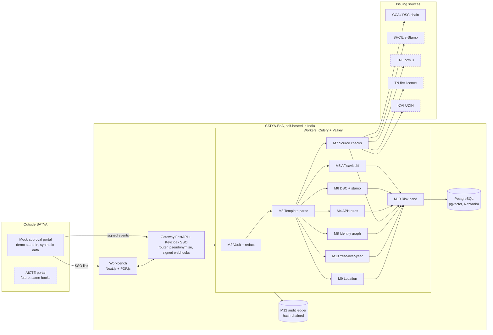

# SATYA-EoA
**Decision support for AICTE Extension of Approval (EoA) scrutiny.** SATYA-EoA reads the documents an institution submits, checks each one at its official source where one exists, and compares what was sworn with the portal's own data and earlier years. It gives officials evidence-linked, advisory findings. Officials make every decision.

Smart India Hackathon 2026 · problem statement **SIH26261** · **Team OneVision**

## What this prototype is, and is not
- **Advisory decision support.** There is no approve, reject or auto-clear control anywhere; every outbound event carries `advisory: true`, `regulatory_effect: "none"`.
- **Officials decide.** Every finding needs a recorded human disposition with a reason.
- **Runs against a mock portal** that the team built ("Approval Portal (Mock, for demo)"). It shows the hooks a real portal would need; it is not a real integration.
- **Synthetic data only.** No real institutions, people, IDs or documents.
- **Not affiliated with, endorsed by or connected to AICTE.**

## Architecture

```
Legend: dashed = mock adapter or proposed hook in the demo. CCA/DSC is a real offline check (against a test anchor on synthetic documents).

Slice 0 runtime details: [docs/ARCHITECTURE.md](docs/ARCHITECTURE.md).

## Quick start
Needs Docker (with Compose), `make` and `python3`. On Windows use WSL2: see [docs/DEV-SETUP.md](docs/DEV-SETUP.md).
```bash
make secrets     # random secrets into .env (git-ignored)
make up          # build, start all services, wait until healthy
make trust-ca    # export the local HTTPS root CA once, then trust it (DEV-SETUP)
```
Then open **https://localhost** and sign in as `rb.southern.demo`: run `make demo-reset` first; the queue lists five synthetic cases; open `1-90000004217` and its *Affidavit diff* tab to see RB-05 (`docs/DEMO-NOTES.md` has the click path) (password: `grep DEMO_USER_PASSWORD .env`). The mock portal is at **https://portal.localhost**: press *Send test event* and watch the signed event get a receipt.

## Demo flow (Slice D)
`make demo-reset` (after `make up`) loads the same five synthetic cases every time and records their intake and first checks in the ledger. Sign in as `rb.southern.demo`: the queue shows each case with a High, Medium or Low band, label counts and status; a case shows its documents with one of the six labels, source answers, findings with the rule, APH clause, extracted and expected values and a fixed-template reason, and a PDF viewer that opens at the finding. An official records one of five dispositions with a reason. `/audit` shows the hash chain with a recomputed "chain verified" status; `/alerts` lists alerts derived from stored data.

What is real and what is not: all data is synthetic; the approval portal is a mock; every source answer (SHCIL e-stamp, ICAI UDIN) is a MOCK SOURCE; the signature chain is checked offline against a TEST TRUST ANCHOR that proves nothing outside this repository. SATYA advises; officials decide; there is no approve or reject control. Results are "all planted cases detected on synthetic test sets"; the generator and the rules were written together, so this says nothing about real documents. Not built: scans and OCR, intake vault, identity graph, year-over-year, EVC, the full mock portal, Hindi for these screens. See [docs/DEMO-NOTES.md](docs/DEMO-NOTES.md) and [docs/DEMO-CHECKLIST.md](docs/DEMO-CHECKLIST.md).

## Status
| Slice | Scope | Status |
|---|---|---|
| 0 Foundation | Monorepo, compose stack with HTTPS, shared contracts, signed event gateway + hash-chained ledger, Keycloak SSO, workbench shell, mock portal test event, CI with secret scan and real-data guard | Built |
| 1 M5 | Affidavit 2 diff and reconciliation (P-3), RB-05 DiffView; all planted cases detected on synthetic test sets | Built on synthetic data |
| 2 M6 | Real signature vs image, test trust anchor, stamp chronology, UDIN (P-4, P-18), RB-05/RB-06 badges; all planted cases detected on synthetic test sets | Built on synthetic data |
| Intake + vault | Document intake and vault (P-19) | Planned |
| Demo flow (Slice D) | Seed and reset, upload, six labels with mock sources, queue with risk band, flags with evidence viewer, five dispositions, audit with chain check, alerts (P-10, P-11, P-12 first cut) | Built on synthetic data |
| Workbench | Remaining screens (manual tasks RB-09, case replay, Hindi) | Planned |
| Mock portal | Complete screens and events (P-17) | Planned |
| M3 | Template-aware extraction and OCR on synthetic templates (P-2, P-6) | Planned |
| M13, M7, M4, M8 | Year-over-year (P-8), source adapters (P-5), APH date rules (P-7), identity graph (P-9) | Planned |
| M1 / M9 | Category router, coordinates (P-1, P-13) | Planned |

Build order follows decision #40 (hardest first). The backlog is in [docs/ISSUES.md](docs/ISSUES.md).

## Repository
| Path | Contents |
|---|---|
| `apps/web` | SATYA workbench (Next.js) |
| `apps/mock-portal` | Approval Portal (Mock, for demo) |
| `packages/affidavit` | M5 affidavit diff engine + synthetic Affidavit 2 generator (`satya_affidavit`) |
| `services/api` | FastAPI gateway |
| `services/worker` | Celery worker on Valkey |
| `packages/shared-types` | JSON Schema contracts → TypeScript + Pydantic |
| `infra` | Docker Compose, Caddy, Keycloak realm, scripts |
| `docs` | Specs, setup, architecture, versions, decisions, backlog |

Working on the code: start with [CLAUDE.md](CLAUDE.md) (rules and commands), then [docs/DEV-SETUP.md](docs/DEV-SETUP.md).

## Licence
None yet. The team plans Apache-2.0 when the repository goes public, if the SIH rules allow it.
