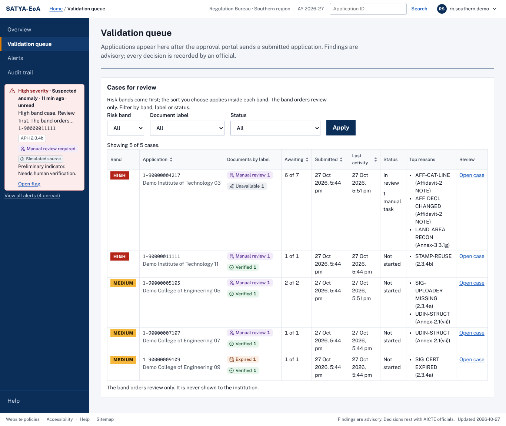

# SATYA-EoA

**Decision support for AICTE Extension of Approval (EoA) scrutiny.**

SATYA-EoA is a decision-support platform that helps AICTE officials check Extension of Approval applications and the documents that come with them. It reads the affidavit and supporting documents, checks signatures, stamp dates and UDINs, compares what was sworn with the approval portal's own data, and shows officials findings with the evidence behind each one. It only advises: every decision is made and recorded by an official.

Built by Team OneVision for Smart India Hackathon 2026, problem statement SIH26261. It is a prototype that runs against a mock approval portal on synthetic data.



*The validation queue, on synthetic cases only (screenshot from an earlier build; wording may differ from the current screens).*

## The gap it targets

Under the Approval Process Handbook 2024-27 (Table 2.3), an Extension of Approval based on self-disclosure has no Scrutiny Committee, Expert Visit Committee or Standing Hearing Committee before approval. SATYA-EoA is meant to give that path a first-pass scrutiny of the sworn documents, and to give any committee that comes later the evidence already gathered.

## What is built, what is simulated, what is planned

| Status | Feature |
|---|---|
| Built | Affidavit comparison against the portal draft (24 declarations) |
| Built | Real versus printed digital signatures, edited-after-signing detection and stamp-paper date order |
| Built | UDIN structure checks |
| Built | Evidence-linked flags with five dispositions |
| Built | Risk bands, queue, alerts and overview |
| Built | Hash-chained audit trail with deterministic replay |
| Built | Scan fallback with OCR in English (reason codes; OCR text never decides anything) |
| Built | Seven automated CI checks |
| Partial | Six verification labels, with e-Stamp, UDIN and signature-chain sources that are simulated (tagged "Simulated source" and "Test trust anchor") |
| Partial | Mock approval portal with webhooks and single sign-on |
| Planned, not built | Tamil and Hindi OCR |
| Planned, not built | Tamil Nadu building-licence and fire-licence adapters |
| Planned, not built | Issuer-profile checks |
| Planned, not built | Handbook date rules |
| Planned, not built | Land rule |
| Planned, not built | Year-over-year checks |
| Planned, not built | Faculty identity checks |
| Planned, not built | Infrastructure evidence review (photo reuse, GPS, floor-plan area) |
| Planned, not built | Redaction and tokenisation vault |
| Planned, not built | QR-code decoding |
| Planned, not built | Ranked expert-visit selection |

## Simulated and not connected

- No connection to AICTE, CCA, SHCIL, ICAI or any issuer exists. SATYA-EoA is designed to integrate through REST, signed webhooks and single sign-on, but none of that has been connected to a real system.
- The approval portal is a mock that this project builds ("Approval Portal (Mock, for demo)").
- Source answers (e-Stamp, UDIN) are simulated and tagged "Simulated source" in the workbench.
- The signature chain is checked against a test certificate authority that exists only in this repository (tagged "Test trust anchor"). It proves nothing outside this repository.
- All data is synthetic. SATYA-EoA is not affiliated with, endorsed by or connected to AICTE.

## How it works

1. **Receive.** The mock portal sends a signed event (HMAC-SHA256, with replay protection and de-duplication) when an application is ready. The gateway verifies it and records it.
2. **Identify.** Each uploaded file is hashed and each page is classified as text or scan.
3. **Read.** Text pages are read from their text layer; scanned pages are read by OCR in English. Anything that cannot be read with confidence becomes "manual review required" with a plain reason.
4. **Check.** The affidavit is compared with the portal draft; signatures, stamp-paper dates and UDIN structure are checked. Each finding names its rule, the Handbook clause and the extracted and expected values.
5. **Verify.** Each document gets one of six labels (verified, mismatch detected, expired, verification pending, source unavailable, manual review required) from simulated sources.
6. **Review.** An official sees the case with a risk band, opens each finding in the PDF at the place it came from, and records one of five dispositions (accept, override, or escalate for clarification, referral or manual verification) with a written reason. Every step is a hash-chained audit entry, and a case can be replayed later.

The risk band orders the review queue only; it is never shown to the institution.

## Stack

- Workbench and mock portal: Next.js, React, TypeScript, PDF.js, React Aria Components, next-intl (English and Hindi)
- Gateway: FastAPI (Python 3.13), PostgreSQL with pgvector
- Worker: Celery on Valkey
- Sign-in: Keycloak (OIDC)
- Document checks: pdfplumber, pyHanko; optional PaddleOCR for scans
- Edge: Caddy with local HTTPS
- Contracts: JSON Schema, with generated TypeScript types and Pydantic models
- Packaging: Docker Compose, pnpm and uv workspaces

Exact versions are in [docs/STACK-VERSIONS.md](docs/STACK-VERSIONS.md).

## Repository layout

| Path | Purpose |
|---|---|
| `apps/web` | SATYA workbench (Next.js) |
| `apps/mock-portal` | Mock approval portal ("Approval Portal (Mock, for demo)") |
| `services/api` | FastAPI gateway: signed events, workbench API, audit ledger, replay |
| `services/worker` | Celery worker and scheduler on Valkey |
| `packages/shared-types` | JSON Schema contracts, with generated TypeScript and Pydantic code |
| `packages/affidavit` | Affidavit extraction, normalisation and comparison, with a synthetic affidavit generator |
| `packages/forensics` | Signature, stamp-date and UDIN checks, with a synthetic signed-document generator and a test certificate authority |
| `packages/ocr` | Scan fallback: page classifier, hardening for damaged files, OCR engine interface |
| `packages/rules` | Versioned YAML rules with Handbook clause references |
| `packages/templates` | Year-versioned template profiles |
| `packages/blindgen` | Independent generator and evaluator for synthetic test sets |
| `packages/issuers` | Placeholder for planned issuer profiles |
| `data/synthetic` | Synthetic demo cases, prior-filings register and the public test certificates |
| `infra` | Docker Compose, Caddy, Keycloak realm, helper scripts |
| `docs` | Specs, architecture, setup, decision logs ([index](docs/README.md)) |
| `tests` | Cross-service smoke tests and browser acceptance scripts |

## Quick start

Prerequisites: Docker with Compose, `make`, `python3` and [`uv`](https://docs.astral.sh/uv/) (the demo reset uses it). The service memory limits in `infra/docker-compose.yml` add up to under 8 GiB (checked by `make mem-check`), so give Docker at least that much. On Windows use WSL2; see [docs/DEV-SETUP.md](docs/DEV-SETUP.md) for Windows, Linux and macOS steps.

```bash
make secrets       # writes .env (git-ignored) with random secrets
make up            # builds and starts every service, waits until healthy
make trust-ca      # exports the local HTTPS root CA; trust it once (see docs/DEV-SETUP.md)
make demo-reset    # loads eight synthetic cases with an empty audit trail
```

`make up` builds the API image with the OCR engine by default (`WITH_OCR=1`; network is needed at build time only). Use `WITH_OCR=0 make up` for a faster build without it; scans then report that OCR is not available.

Then open:

| URL | What |
|---|---|
| https://localhost | SATYA workbench |
| https://portal.localhost | Mock approval portal |
| https://localhost/api/v1/health | Gateway health |

Demo users are synthetic accounts (for example `rb.southern.demo`, a Regulation Bureau official) created by the sign-in service when the stack starts. They all share one password, generated randomly by `make secrets` and stored as `DEMO_USER_PASSWORD` in your local `.env`. No password is committed to this repository. [docs/DEMO-NOTES.md](docs/DEMO-NOTES.md) has a click path through the demo cases.

Checks you can run without the stack:

```bash
pnpm install --frozen-lockfile && uv sync --all-packages --frozen
make lint
make typecheck
make test
```

## Data policy

Synthetic data only. The repository contains no real documents, institutions, people, identifiers or credentials. Demo institutions are named "Demo Institute of Technology NN" and similar; application IDs use the reserved `1-9...` range; emails use `example.invalid`. Two automated checks run in CI on every push: a real-data guard (`make guard`) that fails on personal-data patterns or tracked real samples, and a secret scan with gitleaks (`make secret-scan`). See [data/synthetic/README.md](data/synthetic/README.md).

## Safeguards

- SATYA-EoA advises; officials decide. There is no approve, reject or auto-clear control anywhere.
- Every outbound event is marked `advisory: true` and `regulatory_effect: "none"`.
- A disposition is recorded by an official with a written reason of at least 10 characters.
- Findings that point to possible forgery are labelled "Preliminary indicator. Needs human verification."
- Status is never shown by colour alone; each status has a text label.

## Known limitations

- Scanned documents are read by OCR and compared with low confidence; the wording shown for scans is still being improved.
- The tests use synthetic documents that were written together with the rules, so passing them says nothing about real documents.
- Blind-set evaluation is incomplete and unpublished.
- Everything listed as planned above is not built.

## Licence

Apache License 2.0. See [LICENSE](LICENSE) and [NOTICE](NOTICE). Third-party components are listed in [THIRD_PARTY_NOTICES.md](THIRD_PARTY_NOTICES.md).

## References

- AICTE Approval Process Handbook 2024-27 (Table 2.3 on the self-disclosure path). A digest of the clauses used by the rules is in [docs/specs/03-APH-digest.md](docs/specs/03-APH-digest.md).
- Smart India Hackathon 2026, problem statement SIH26261; a copy is in [docs/specs/02-problem-statement-SIH26261.md](docs/specs/02-problem-statement-SIH26261.md).

Contributing: [CONTRIBUTING.md](CONTRIBUTING.md). Reporting a vulnerability: [SECURITY.md](SECURITY.md).
