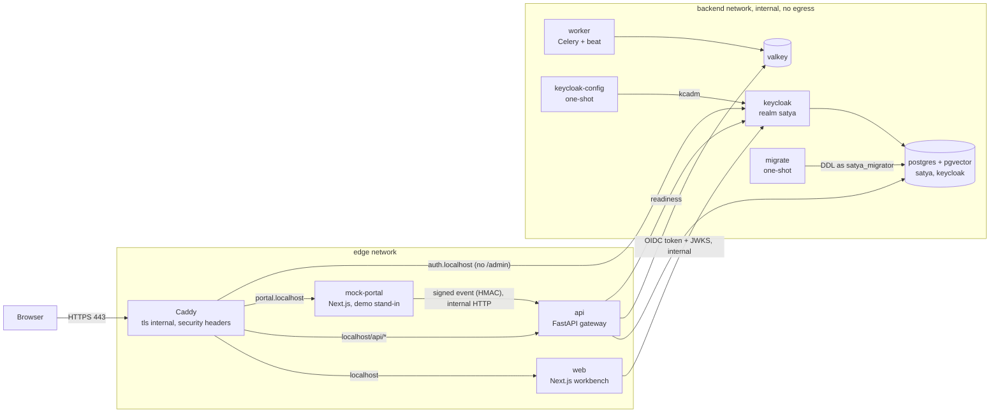
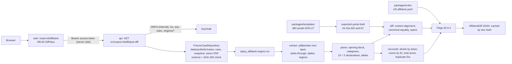
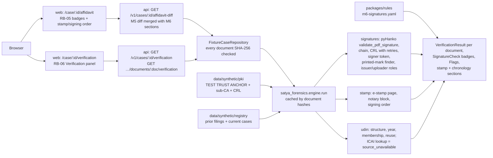

# Architecture (slices 0–1)
What is built now, and where the later modules (M1–M13) attach. The target design is in `docs/specs/01-design-v2.2.1.md` and `docs/specs/04-portal-integration-spec.md` §8.

## Runtime view

Only Caddy publishes ports. The backend network is `internal`, so Postgres, Valkey, Keycloak and the worker have no route to the internet.

## Signed event path (built and tested in slice 0)
1. The mock portal builds a synthetic `application.precheck_requested` envelope (`packages/shared-types`), signs `t.body` with HMAC-SHA256 server-side and posts it with `X-SATYA-Signature: t=…,kid=…,v1=…`.
2. The gateway, in order: per-IP rate limit → body limit (413) → content type → signature (constant-time; `SIGNATURE_INVALID` / `SIGNATURE_EXPIRED` outside ±300 s) → per-client (`kid`) rate limit → JSON → `spec` and inbound `type` → JSON Schema (`EventEnvelope`) → supported AY → if a snapshot is present, X fields refused (`PERSONAL_DATA_REJECTED`) and `ApplicationSnapshot` validated.
3. In one transaction under an advisory lock: drop a >30-day-old copy of the `event_id`, return the existing receipt if it is a duplicate (`200 {duplicate:true}`), else append `sha256(body)` to the ledger (`hash = sha256(prev_hash ‖ payload_sha256 ‖ at)`) and record the event metadata (`202 {receipt_id, duplicate:false}`).
4. Nothing but metadata and the body hash is stored. `make ledger-verify` recomputes the chain.

Errors are RFC 9457 `application/problem+json` with `code` and `trace_id`; stack traces stay in the JSON logs.

## Sign-in path
Browser → `https://localhost` → `/signin` → Auth.js (`/auth/*`) → Keycloak (`https://auth.localhost`, code + PKCE S256) → `/auth/callback/keycloak`. Auth.js discovers Keycloak through `http://keycloak:8080` (token and JWKS calls stay internal) while the browser and the token `iss` use the public URL (`KC_HOSTNAME_BACKCHANNEL_DYNAMIC`). The session is an encrypted HttpOnly cookie with username, roles and regions only. Roles and region are enforced on the server in every protected layout/page; the wrong role gets HTTP 403 "Not assigned to you".

## Data contracts
`packages/shared-types/schemas/*.schema.json` is the single source of truth. `make gen-types` produces TS types, Pydantic v2 models, constants (label precedence, event-type lists, alert subtypes, snapshot field handling) and a bundled schema used for runtime validation. CI fails if regenerated code differs from the commit.

## Security layers
| Layer | Control |
|---|---|
| Edge (Caddy) | HTTPS only (308 from HTTP), HSTS, X-Content-Type-Options, Referrer-Policy, X-Frame-Options DENY, Permissions-Policy, fallback CSP, `frame-ancestors 'none'`, body size limit on `/api`, Keycloak `/admin` not routed |
| Apps | Per-request nonce CSP, server-side authorisation, Origin-checked POSTs (server actions, `/signout`), HttpOnly/Secure/SameSite cookies, no source maps, robots disallow |
| Gateway | HMAC per `kid` with rotation overlap, rate limits per IP and per client, body limit, strict CORS, schema validation, X-field rejection, RFC 9457 errors, JSON security logs |
| Data | Least-privilege roles (`satya_migrator` DDL, `satya_app` DML only), append-only ledger (trigger + grants), no payload storage yet |
| Identity | Keycloak: brute-force detection, password policy, no registration, events stored, secrets from `.env` |
| Repo | `.env` and `data/real-samples/` git-ignored; gitleaks and the real-data guard in CI |

## M5 affidavit diff path (slice 1)

- The engine is a pure, deterministic library (`packages/affidavit`); the API runs it off the event loop, one job at a time, and caches by document hash. The worker will call the same library once the ingest path exists.
- Slice 1 reads the committed synthetic cases. The ingest path (`application.submitted` → M2 fetch + hash → worker → stored result) replaces `FixtureCaseRepository` with P-19/P-17.
- The web server holds the official's 5-minute access token in the encrypted session cookie and calls the API over the internal network; on expiry it sends the official through a silent SSO renewal.

## M6 signatures, stamp chronology, UDIN path (slice 2)

- `packages/forensics` (satya_forensics) is a pure library like M5: the same bytes, snapshot, register and CRLs give the same JSON. Its `synth/` subpackage (reportlab, pyHanko signing) is test/demo tooling and is never imported by the engine.
- Document label = most severe check outcome (Portal §2.6.3); `verified` needs a passing issuer signature or source lookup, so a valid uploader DSC never makes a document verified.
- M7 (P-5) adds `source_lookup` checks (SHCIL e-stamp, TN Form D, TN fire) to the same `VerificationResult` and RB-06 rows; the ICAI UDIN lookup stays `source_unavailable` until an access route exists.

## Where later slices attach
| Module | Attaches at |
|---|---|
| M2 vault (P-19) | gateway after step 2: fetch `documents[]`, hash check, tokenise T fields, encrypt at rest |
| M3/M4/M7/M8/M13/M9/M10 (M5 and M6 engines exist as libraries) | Celery tasks in `services/worker` (queue on Valkey), results as `Flag` / `VerificationResult` |
| M12 (P-11) | extend `ledger` to every SATYA output; AU screens read it |
| M11 (P-10, P-12) | workbench routes under `apps/web/src/app/(shell)/…`, rail items added in `src/lib/rail.ts` |
| Mock portal (P-17) | MP-01..MP-06 screens, remaining inbound events, "Open in SATYA" deep link |
| M1 (P-1) | router on `application.submitted` |
