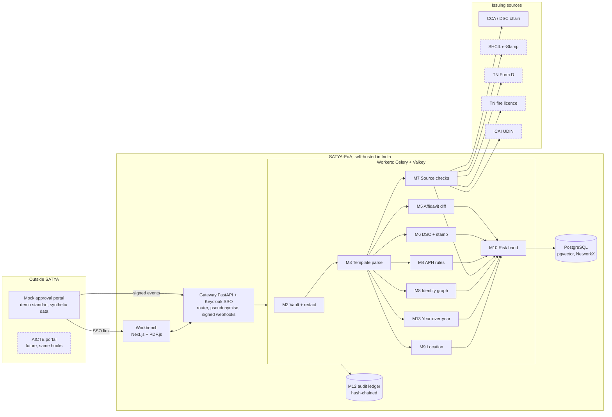
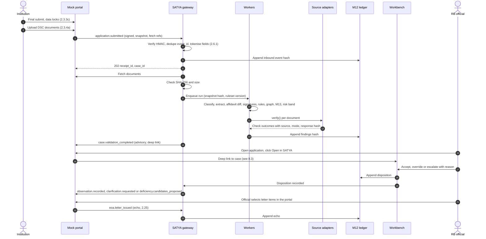
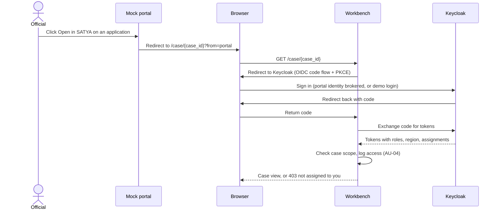
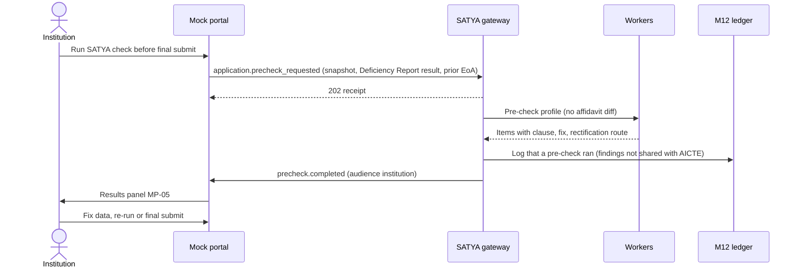
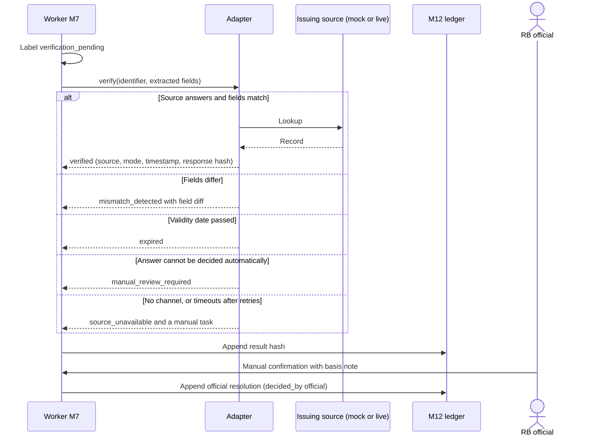
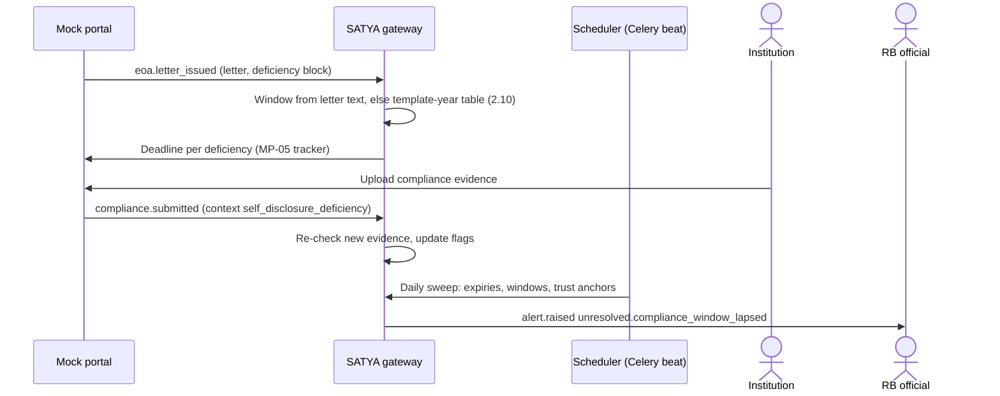

# SATYA-EoA ↔ AICTE portal: integration spec
Repo copy of Portal spec **v0.2.1** (25 Oct 2026). Companion to `01-design-v2.2.1.md` and `05-ui-design-spec.md`. Every process step cites the APH 2024-27 clause. Anything about the real AICTE portal's internals that we cannot confirm is marked **[VERIFY]**.

| § | Section | Status |
|---|---|---|
| 0 | Ground rules | v0.1 |
| 1 | Stage-by-stage flow (C2 stages ①–⑦) | v0.2, adopted |
| 2 | API contract | v0.2, adopted |
| 3 | Data the portal shares / must not share; pseudonymisation; M13 history | In progress (field handling fixed in §2.6.1; key custody: gateway key in demo, AICTE-held key in production) |
| 4 | Issuing-authority adapters | Pending (result shape + `mode` fixed in §2.7) |
| 5 | SSO and roles | Pending (deep-link sequence in §8.3) |
| 6 | Security and audit | Pending |
| 7 | Mock AICTE portal for the demo | Pending (screens MP-01…06 in UI spec) |
| 8 | Diagrams | v0.2, adopted |

## 0. Ground rules (fixed)
- **Model:** API-first service (REST + webhook) + an SSO-linked workbench (Keycloak, OIDC). Self-hosted in India; no foreign LLM APIs.
- **Prototype runs against a MOCK AICTE portal that we build.** We never claim real integration, real AICTE data or real API access.
- **The real portal has no published integration API, webhooks or SSO that we know of [VERIFY].** Every "portal sends" item is a **proposed hook**: what AICTE would add (signed webhooks on state changes + an "Open in SATYA" link) to adopt SATYA. The mock portal implements these hooks.
- **SATYA writes nothing adverse into the portal.** It returns advisory findings only; every outbound event carries `advisory: true` and `regulatory_effect: "none"`. Every portal-side status change (deficiency posted, approval, rejection, show-cause, penalty) is done by an AICTE official in the portal, and SATYA records it from the echoed event.
- **D2 rule:** SATYA imports the portal Deficiency Report result; it never recomputes those norms.

## 1. Stage-by-stage flow
`→S` = portal to SATYA (proposed webhook), `S→` = SATYA to portal.

| Stage (C2) | Trigger and what the portal sends `→S` | What SATYA does (modules) | What goes back `S→` | Who acts (APH) |
|---|---|---|---|---|
| **① Pre-submission self-check** (institution, before the data lock) | Institution clicks "Run SATYA check" before final submission. `→S application.precheck_requested`: `ApplicationSnapshot` (§2.6.1), **Deficiency Report result** (2.3.3b), previous EoA letter + last year's snapshot (M13). Optional: external certificates the institution already holds. | M1 route (Table 2.3 → Annexure-2); M4 rules **not covered by D2** (fire / Form D validity, partial-OC 2-year counter Annex-3 3.1c, 30-year structural rule 2.1(iv), lease vs longest course 2.1(e)); internal-consistency rules on the snapshot (D5.5); M13 diff; M3/M6/M7 on optional certificates. **No sworn-affidavit diff** (note 1). | `S→ precheck.completed`, audience institution only: items with APH clause, how to fix, rectification route. | Institution enters and corrects data (2.3.1a); reaches Nil Deficiency (2.4); data locks on final submission (2.3.3c); one reopening with Format 3 + TER + penalty (2.3.3d–e). |
| **② Self-disclosure EoA validation** (no committee; Table 2.3) | After final submission and DSC uploads (2.3.3c, 2.3.4a). `→S application.submitted`: locked `ApplicationSnapshot`, the **portal-generated affidavit draft for this AID**, the 7 Annexure-2.1 documents as fetch references, TER status, Deficiency Report result, previous EoA letter(s), faculty export (pseudonymised). Reopening: `→S application.reopened`, then a new `application.submitted`. | M2 hash + redact + DSC capture → M3 content-based classification + template-aware extraction → **M5 normalised 24-declaration diff** + reconciliation → M6 signatures (two checks, §2.8), stamp chronology, notary-seal expiry → M7 source checks → M4 rules → M8 identity graph → **M13** → M10 risk band. | `S→ case.validation_completed`: per-document 6-label status with checks, evidence-linked flags, risk band (officials only), deep link. Later, from official dispositions: `observation.recorded`, `clarification.requested`, `referral.recommended`, `deficiency.candidates_proposed`. | Regulation Bureau officials review. EoA is granted on self-disclosure; the Council monitors (2.5); "random" EVC possible (2.3.5a); the institution downloads the EoA letter (2.25). |
| **③ Scrutiny / Re-scrutiny** (Phase 2) | `→S committee.scrutiny_constituted` / `committee.rescrutiny_constituted` + `deficiency_refs` (1.8g). Echo: `→S deficiency.posted`. | Same pipeline + Format 1/2/3 checks, Certificate 2 rooms ↔ affidavit rooms, multiple-copy comparison (D5.11). Re-scrutiny view = posted deficiencies only. | `S→ case.evidence_pack_ready`. No deficiency is posted by SATYA. | Experts verify originals and post deficiencies (1.8). |
| **④ "Random" EVC selection** (Phase 2; band shown in Phase 1) | `→S evc.selection_round_opened`; echo `→S evc.selection_recorded`. | M10 risk ranking + seeded random draw (seed in M12, replayable). | `S→ evc.selection_proposal_ready`. | AICTE decides (2.3.5a) [VERIFY V-4]. |
| **⑤ EVC** (Phase 2) | `→S evc.scheduled`; `→S evc.media_submitted`. | M9 video compliance (1.9 f–g NOTE); checklist from Annex-3/4 + open flags; faculty vs salary-sheet count. | `S→ evc.checklist_ready`, `S→ evc.media_check_completed`. | EVC experts (1.9; 6.14a). |
| **⑥ SHC → EC → SAC** (Phase 2) | `→S hearing.scheduled`; `→S compliance.submitted` (context `hearing`); echo `→S decision.recorded`. | Compliance vs open flags; signed evidence dossier. **Drafts no decision text.** | `S→ case.dossier_ready`. | SHC hears; EC decides (2.23.3); SAC appeal (2.24). |
| **⑦ Monitoring + next cycle** | `→S eoa.letter_issued`; `→S compliance.submitted` (context `self_disclosure_deficiency`); `→S enrolment.uploaded` (2.25n); `→S faculty.record_changed` (6.14c). | Compliance deadline per deficiency (§2.10); expiry sweeps; enrolment vs approved intake after supernumerary seats (7.3); Faculty ID update lag; trust-anchor re-validation; case becomes next year's M13 baseline. | `S→ alert.raised` (§2.9), `S→ document.status_changed`. | Council monitors and takes penal action (2.5; 7.3, 7.4a). |

### Notes on §1
1. **Upload vs data lock.** Data locks (2.3.3c), then DSC uploads (2.3.4a); the affidavit is portal-generated per application (Affidavit-2 NOTE). So the sworn affidavit does not exist before the lock and the affidavit diff belongs to ②. Whether the real portal allows uploads before final submission: **[VERIFY]** (V-2).
2. **Stage ② blocks nothing.** Findings go to officials, who decide.
3. **"Deficiencies Noted based on Self Disclosure".** How the portal fills this table today is unknown **[VERIFY]** (V-3). SATYA sends `deficiency.candidates_proposed`; an official selects or edits items in the portal; the letter echo is the record.
4. **Rectification "wherever permitted"** (PS FR1): before the lock (①); after it only via the one paid reopening (2.3.3d–e) or the compliance routes. SATYA never reopens anything.
5. Every `→S` event is a proposed hook; the mock portal fires them.

### Cross-cutting rules
- **Human gate:** anomaly/forgery-type flags carry "Preliminary indicator. Needs human verification." (PS FR2). A flag reaches a committee pack, dossier or the institution only after an official's disposition.
- **Every flag carries** document hash, page + regions, rule ID + version + APH clause + edition, source response + timestamp (M7 flags), confidence, both years' references (M13 flags).
- **Every inbound event and every SATYA output is appended to the M12 hash-chained ledger.**

## 2. API contract

### 2.0 Two APIs, one schema set
| API | Callers | Auth | Purpose |
|---|---|---|---|
| **Portal Integration API** | Mock portal now; AICTE portal in future | OAuth 2.0 client credentials (Keycloak service client `portal-integration`) + HMAC-signed event bodies; mTLS in production [VERIFY] | Inbound events, outbound webhooks, case/report reads |
| **Workbench API** (internal BFF for `apps/web`) | Officials' browsers via SSO | OIDC user tokens (Keycloak), case-scope checks | Screens in UI spec §6 (`GET /cases`, `/cases/{id}`, `/affidavit-diff`, `/yoy`, `/alerts` …) |

Both use the shared schemas in §2.6 (in `packages/shared-types`). Field names match UI spec §6 exactly.

**Conventions:** base path `/v1`; JSON UTF-8; timestamps RFC 3339 with offset (stored UTC, shown IST); dates `YYYY-MM-DD`; money in paise as integers; IDs are prefixed ULIDs (`cas_`, `evt_`, `doc_`, `flg_`, `run_`, `alr_`, `rcp_`); portal IDs (`application_id`, `permanent_id`) passed as strings in their printed format (`1-` + digits).

### 2.1 Endpoints (Portal Integration API)
| Method + path | Purpose | Success |
|---|---|---|
| `POST /v1/portal-events` | Receive any `→S` event (§2.4). Body = event envelope (§2.3). | `202 {receipt_id, case_id?, duplicate:false}`; duplicate `event_id` → `200 {duplicate:true, receipt_id}` |
| `GET /v1/receipts/{receipt_id}` | Ingest status (fetching / processing / done / failed + error code) | `200` |
| `GET /v1/cases/{case_id}` | Case summary: route, stage, run, document labels, counts | `200` |
| `GET /v1/cases/{case_id}/report?audience=institution\|official` | Structured validation report (institution view filtered per UI §1.1) | `200` |
| `GET /v1/cases/{case_id}/report.pdf?audience=…` | Same, rendered PDF with hash in footer | `200 application/pdf` |
| `GET /v1/cases/{case_id}/documents/{doc_id}/verification` | `VerificationResult` incl. all checks (§2.7) | `200` |
| `GET /v1/cases/{case_id}/dossier` | Signed evidence dossier (⑥; Phase 2) | `200` |
| `GET /v1/evc/selection-rounds/{round_id}` | Selection proposal (④; Phase 2) | `200` |
| `POST /v1/webhook-subscriptions` · `GET` · `DELETE /{id}` · `POST /{id}/rotate-secret` · `POST /{id}/test` | Manage `S→` endpoints and secrets | `201/200/204` |
| `GET /v1/deliveries?status=failed` · `POST /v1/deliveries/{id}/redeliver` | Inspect and replay outbound deliveries | `200/202` |
| `GET /v1/meta` | API + schema versions, supported AYs, APH editions, template profiles, ruleset versions, adapters with `mode` | `200` |
| `GET /v1/health` | Liveness/readiness incl. queue depth and adapter health | `200/503` |

**Documents are pulled, not pushed.** Events carry `documents[]{slot, fetch_url, expires_at, sha256, bytes, mime}`. SATYA fetches each URL, checks SHA-256 and size, then stores it in the M2 vault. A mismatch fails ingest for that document (`DOC_HASH_MISMATCH`, reported via `ingest.failed`). [VERIFY V-1]

### 2.2 Security of the channel
- **Event signature (both directions):** header `X-SATYA-Signature: t=<unix>,kid=<key-id>,v1=<hex HMAC-SHA256 of "t.body">`. Receiver rejects if `|now − t| > 300 s` or the HMAC fails. Secrets per subscription, rotatable with an overlap window (two `kid`s valid).
- **Transport:** HTTPS only (TLS 1.2+); no plain-HTTP fallback.
- **Data minimisation at the gateway:** fields in §2.6.1 marked X are rejected (`PERSONAL_DATA_REJECTED`); fields marked T are tokenised before anything is stored.

### 2.3 Event envelope (both directions)
```json
{
  "spec": "satya.event/1",
  "event_id": "evt_01JB7Q8N3V9Z6K2M4R5T8W0XYZ",
  "type": "application.submitted",
  "occurred_at": "2026-12-14T11:05:42+05:30",
  "producer": "mock-portal",
  "subject": { "application_id": "1-##########", "permanent_id": "1-#######", "ay": "2026-27" },
  "sequence": 17,
  "correlation_id": "cor_01JB7Q8M0000000000000000",
  "data": { }
}
```
- `sequence` is per application and increases by 1. SATYA processes events for one application in order; a gap is held up to 10 minutes, then processed with an `OUT_OF_ORDER` note in the ledger.
- Outbound events add `"advisory": true, "regulatory_effect": "none"`, `case_id`, `run_id` and `deep_link` (opaque path, no personal data, no tokens).

### 2.4 Inbound events (`→S`)
| Type | Stage | `data` (main fields) | APH | Phase |
|---|---|---|---|---|
| `application.precheck_requested` | ① | `snapshot` (§2.6.1), `deficiency_report`, `prior{eoa_letters[], snapshot_ref}`, `documents[]` (optional certificates) | 2.3.1a, 2.3.3b, 2.4 | 1 |
| `application.submitted` | ② | `snapshot` (locked), `affidavit_draft{template_id, ay, category_set[], text_ref}`, `documents[]` (Annexure-2.1 slots 1–7), `ter{status, amount_paise, txn_ref, paid_at}`, `deficiency_report`, `prior{…}`, `faculty_export` (tokenised) | 2.3.3c, 2.3.4a–b, Annex-2.1 | 1 |
| `application.reopened` | ②→① | `reason_ref`, `format3_doc` (fetch ref) | 2.3.3d–e | 1 |
| `committee.scrutiny_constituted` / `committee.rescrutiny_constituted` | ③ | `committee_id`, `member_refs[]`, `window{from,to}`, `documents[]`, Re-scrutiny: `deficiency_refs[]` | 1.8, 1.8g | 2 |
| `deficiency.posted` | ③ (echo) | `deficiency_refs[]{id, text, posted_by_role, posted_at}` | 1.8 | 2 |
| `evc.selection_round_opened` / `evc.selection_recorded` | ④ | cohort refs, quota, `random_share`; echo: selected refs + who recorded | 2.3.5a | 2 |
| `evc.scheduled` / `evc.media_submitted` | ⑤ | `evc_id`, mode, `member_refs[]`, date; media: `video_url` or recording fetch ref, salary statements | 1.9, 6.14a | 2 |
| `hearing.scheduled` | ⑥ | `hearing_id`, `committee: shc\|sac`, `member_refs[]`, date | 2.23, 2.24 | 2 |
| `compliance.submitted` | ⑥ / ⑦ | `context: hearing\|self_disclosure_deficiency`, `deficiency_refs[]`, `documents[]` | 2.23; EoA letter block | 1 (⑦), 2 (⑥) |
| `decision.recorded` | ⑥ (echo) | `decision_ref`, `speaking_order_ref`, `decided_at` | 2.23.3 | 2 |
| `eoa.letter_issued` | ⑦ | letter fetch ref, `f_no`, `date_of_approval`, `deficiencies[]{text, window_text}` | 2.25 | 1 |
| `enrolment.uploaded` | ⑦ | course-wise admitted counts incl. supernumerary heads | 2.25n, 7.3 | 1 |
| `faculty.record_changed` | ⑦ | `faculty_token`, `change: added\|removed`, `effective_date`, `recorded_at` | 6.14c | 1 |
| `complaint.referred` | ⑦ | reserved | 7.10 | later |

### 2.5 Outbound events (`S→`)
| Type | When | `data` (main fields) | Audience in portal |
|---|---|---|---|
| `precheck.completed` | ① run done | `items[]` (UI §6.6 shape), `ruleset_version` | Institution |
| `case.validation_completed` | ② run done | `documents[]{doc_id, slot, label, checks_summary}`, `label_counts`, `flag_count`, `risk_band`, `top_reasons[≤3]`, `deep_link` | Officials |
| `case.evidence_pack_ready` | ③ | `pack_ref`, `committee_id`, labels, flags | Committee |
| `evc.selection_proposal_ready` / `evc.checklist_ready` / `evc.media_check_completed` | ④ / ⑤ | proposal, checklist, media results | RB / EVC |
| `case.dossier_ready` | ⑥ | `dossier_ref`, `sha256`, `changes_since_last_stage[]` | SHC / SAC |
| `document.status_changed` | any | `doc_id`, `from`, `to`, `reason_code`, `decided_by: system\|official` | Officials |
| `alert.raised` | any | `Alert` (§2.9) | Per alert audience |
| `observation.recorded` | Official chooses Accept | `flag_id`, `summary_key`, `aph_clause`, `recorded_by_role`, `ledger_no` | Officials |
| `clarification.requested` | Escalate → ask institution | `request_id`, `flag_ref` (opaque), `shared_evidence[]{doc_id, page, crop_ref}`, `official_note`, `due_date` | Institution (MP-05) |
| `referral.recommended` | Escalate → refer to Scrutiny/EVC | `flag_ids[]`, `target: scrutiny\|evc`, `reason`, `recorded_by_role` | Officials |
| `deficiency.candidates_proposed` | Official marks Accepted flags as letter items | `candidates[]{flag_id, text_key, aph_clause}` | Officials |
| `ingest.failed` | Fetch/hash/schema failure after `202` | `receipt_id`, `error_code`, `slot?` | Portal operator |

**Not emitted:** Override and Escalate → manual verification stay inside SATYA (ledger + RB-09 task). An undo emits `observation.withdrawn` referencing the earlier event. No event ever carries a recommendation to approve, reject or penalise.

### 2.6 Core schemas

#### 2.6.1 `ApplicationSnapshot` = the Application Report field set
Handling at the gateway: **K** keep · **T** tokenise (keyed HMAC-SHA256; key never stored with the data) · **X** must not be sent (rejected) · **R** result only (keep the portal's computed value, not the input).

| Group | Fields | Handling | Used by |
|---|---|---|---|
| `basic` | application_id, permanent_id, institution type, status, application/submission dates, regional office, **overall_deficiency** (flag only; blank = unknown) | K | M1, M4, M13 |
| `trust` | trust/society/company name, registration ref | K | M5, M7 |
| `trustees[]` | name → `trustee_token`; role; tenure from/to | name **T**; role, tenure K | tenure-expired rule; signer match |
| `authorised_signatory` | Chairman/Secretary name → `signatory_token` | **T** | M6 signer check (§2.8) |
| `hoi` | HOI personal details (name, DOB, contact, PAN, address) | **X**; only the Deficiency Report's principal-eligibility result | **R** via `deficiency_report` |
| `courses[]` | programme, level, intake approved for last 2 AYs, applied intake, required vs actual faculty, NRI status, International-students status, NBA | K | M4, M13 |
| `land` | total area + unit, pieces, max distance, land-use certificate issuer/date, coordinates D/M/S + N/S, E/W | K | M9 (≤3 plots ≤2 km) |
| `land.deeds[]` | deed holder → `holder_token`; document no. → `deed_token`; registration date; plot no.; village/district; area | holder, doc no. **T**; rest K | M5 land table ↔ affidavit; M13 |
| `buildings[]` | block, sanctioned vs constructed area, Building Plan Approving Authority + date | K | M9 vs fire/Form D area and height |
| `rooms` | 4 blocks (administrative, amenities, instructional, instructional-common): room id, type, carpet m², 3 completion columns | K | M5 room tables; room-ID uniqueness |
| `facilities`, `committees` | as printed | **R** (D2) | display only |
| `bank` | bank name, IFSC; account number | name, IFSC K; account no. **X** | stale-IFSC rule |
| `finance` | income and expenditure totals by head, FY | K | totals consistency |
| `declaration` | items a–f, category list in f) | K | category set cross-check |
| `faculty[]` | faculty_id → `faculty_token`; PAN, DOB, name, mobile, email **X**; portal's `is_duplicate`, `pan_validation`, `record_status` **R**; designation, appointment type, programme, department, date of joining, highest qualification level, relieved date | as marked | M8, 6.14c lag |
| `deficiency_report` | template year, per-section Yes/No, overall | **R** | M4 imports (D2) |

Tokens are stable across institutions and years (same key) so M8/M13 can link records without names. Faculty ID tokenisation is reversible only through a logged official "reveal" (AU-04). **Key custody:** the SATYA gateway holds the key in the demo; in the production design AICTE holds it and SATYA receives only tokens.

#### 2.6.2 `Document`
`doc_id, slot, declared_type, classified_type (by body text/issuer), format_type T|E|P, template_id?, sha256, bytes, page_count, received_at, signatures[] (§2.8), verification (§2.7), flag_count`. When `declared_type ≠ classified_type`, a `suspected_anomaly.document_misclassified` flag is raised.

#### 2.6.3 Six labels
`verified | mismatch_detected | expired | verification_pending | source_unavailable | manual_review_required`

| Label | Meaning in SATYA | Set by |
|---|---|---|
| `verified` | An authenticity check (issuer signature or official-source lookup) passed and nothing worse was found | System or official |
| `mismatch_detected` | The source or signature contradicts the document (field differs, digest broken, revoked, edited after signing) | System or official |
| `expired` | The document or its signing certificate was not valid on the relevant date | System or official |
| `verification_pending` | A check is queued, running or retrying | System |
| `source_unavailable` | No official channel exists for this document type/state, or the channel stayed unreachable after retries. **Creates a manual-verification task (RB-09).** | System |
| `manual_review_required` | A channel answered but the result cannot be decided automatically (image-only signature, untrusted chain, fuzzy signer match, low-confidence identifier, conditional clauses), or an official routed it | System or official |

- **Document label = most severe check outcome**, order: `mismatch_detected` > `expired` > `manual_review_required` > `source_unavailable` > `verification_pending` > `verified`. `verified` also requires at least one authenticity check.
- **A valid uploader DSC never makes a document `verified`.**
- An official resolves `source_unavailable` / `manual_review_required` to `verified`, `mismatch_detected` or `expired` with a basis note; the result carries `decided_by: official`.

#### 2.6.4 `Flag`
`flag_id, doc_id, page, regions[]{x,y,w,h} (normalised 0–1), rule_id, rule_version, rule_text_key, aph_clause, aph_edition, extracted_value, expected_value, value_unit, delta?, extracted_source{doc_label,page,row?}, expected_source{label}, confidence (0–1), confidence_band, label, provenance satya|portal, preliminary_indicator, severity info|warning|critical, disposition{action, reason, by_role, at}|null, check_ref?, stage, institution_visible, yoy{ay_a_ref, ay_b_ref, verdict}?, evidence_sha256`.

#### 2.6.5 `Disposition`
`action: accept | override | escalate_clarify | escalate_refer | escalate_manual`, `reason` (≥10 chars), `reason_template_id?`, `by_user_ref`, `by_role`, `at`, `ledger_no`.

### 2.7 `VerificationResult` and adapter result shape
```json
{
  "doc_id": "doc_01JB…",
  "label": "manual_review_required",
  "decided_by": "system",
  "checks": [
    { "kind": "issuer_signature", "outcome": "manual_review_required", "reason_code": "SIG_IMAGE_ONLY",
      "evidence": { "page": 2, "regions": [{ "x": 0.61, "y": 0.83, "w": 0.30, "h": 0.07 }] } },
    { "kind": "source_lookup", "outcome": "verified", "reason_code": "SRC_MATCH",
      "source": { "adapter_id": "tn-fire-licence", "mode": "mock", "name": "TN fire licence (mock)" },
      "checked_at": "2026-12-14T11:07:10+05:30", "response_sha256": "…", "attempts": 1,
      "field_diff": [] },
    { "kind": "expiry", "outcome": "verified", "reason_code": "VALID_ON_PROCESSING_DATE",
      "valid_from": "2025-03-01", "valid_to": "2028-02-29", "basis": "printed" }
  ]
}
```
- `check.kind`: `issuer_signature | uploader_signature | source_lookup | qr_consistency | expiry | format | chronology`.
- `source.mode`: `live | mock | offline | none`. **Every mock result is labelled "MOCK SOURCE" in the UI and in every report and dossier.**
- `field_diff[]{field, submitted, source}` drives `mismatch_detected`.
- `expiry.basis`: `printed | computed_from_state_rule`.

**TN adapters.** `tn-form-d` and `tn-fire-licence` run in **mock mode**: synthetic licence numbers, responses built from the fields printed on real licences. The real e-District response format is not captured yet [VERIFY V-6]. A live lookup is a Phase 2 adapter behind a flag. TN fire QR decoding is real (offline) but the QR holds plain text, so it gives only a `qr_consistency` check, never `verified` on its own.

### 2.8 Signature checks → 6 labels
Two checks per document: `issuer_signature` and `uploader_signature` (2.3.4a).

| Situation | Outcome | `reason_code` |
|---|---|---|
| Real CMS signature (/ByteRange), digest intact, chain builds to a configured trust anchor (**CCA Root in production; a SATYA test root in the demo, always shown as "TEST TRUST ANCHOR"**), certificate valid at signing time, revocation OK or LTV data present, no disallowed changes after signing | `verified` | `SIG_VALID` |
| Digest does not match the signed byte range | `mismatch_detected` | `SIG_DIGEST_MISMATCH` |
| Changes after signing beyond what the signature permits; benign incremental updates are **not** flagged. pyHanko modification analysis [VERIFY exact API during build] | `mismatch_detected` | `SIG_MODIFIED_AFTER_SIGNING` |
| Certificate revoked before the signing time | `mismatch_detected` | `SIG_CERT_REVOKED` |
| Certificate expired or not yet valid at the signing time | `expired` | `SIG_CERT_EXPIRED` |
| Chain does not build to a trust anchor (self-signed, unknown CA) | `manual_review_required` | `SIG_UNTRUSTED_CHAIN` |
| Printed "Digitally signed by … / Signature valid" mark with **no /ByteRange** (image only) | `manual_review_required` | `SIG_IMAGE_ONLY` |
| Valid signature but signer ≠ authorised Chairman/Secretary (token comparison) | `manual_review_required` | `SIG_SIGNER_NOT_MATCHED` |
| OCSP/CRL unreachable | `verification_pending` → after retries `source_unavailable` | `SIG_REVOCATION_UNREACHABLE` |
| No uploader DSC where 2.3.4a requires one | **no label**; flag `missing_info.uploader_dsc_missing` | `UPLOADER_DSC_MISSING` |

### 2.9 Alert schema and enum
`Alert {alert_id, type, subtype, severity info|warning|critical, audience_roles[], case_id, application_id, flag_id?, doc_id?, label?, aph_clause?, text_key, due_at?, created_at, read}`.

| `type` | `subtype` |
|---|---|
| `missing_info` | `document_missing`, `field_missing`, `category_line_missing`, `uploader_dsc_missing` |
| `expired` | `document_expired`, `expiring_soon` (default 60 days, configurable), `partial_oc_limit_reached`, `signing_cert_expired` |
| `pending_source` | `source_pending_overdue`, `source_unavailable`, `trust_anchor_revalidation` |
| `suspected_anomaly` | `affidavit_diff`, `signature_integrity`, `signature_image_only`, `stamp_chronology`, `identity_graph`, `yoy_discrepancy`, `document_misclassified`, `media_reuse` (Phase 2) |
| `unresolved` | `flag_undisposed_overdue`, `manual_task_overdue`, `clarification_overdue`, `compliance_window_expiring`, `compliance_window_lapsed` |
| `role` | `case_assigned`, `sitting_scheduled`, `evc_scheduled`, `hearing_scheduled`, `selection_round_opened` |

Institution-facing alerts are limited to `missing_info`, `expired`, `unresolved.clarification_*` and `unresolved.compliance_window_*`.

### 2.10 Compliance window for self-disclosure deficiencies
1. **Primary:** parse the window from the letter's own deficiency block ("within Six Months …", "Two years …").
2. **Fallback:** template-year table: AY 2020-21 → 2 years; AY 2024-25 → 6 months. Other years [VERIFY].
3. Neither → `window: unknown`, item routed to manual review; no deadline is invented.
4. Deadline = letter's "Date of Approval" (2024+) or "Date" (earlier templates) + window.
5. Evidence arrives through the portal as `compliance.submitted` with `context: self_disclosure_deficiency`; SATYA re-checks it.
6. Alerts: `compliance_window_expiring` 30 days before the deadline (configurable); `compliance_window_lapsed` after it.

### 2.11 Idempotency, delivery, retries, ordering
- **Inbound events:** `event_id` deduplicated for 30 days; a repeat returns `200 {duplicate:true}`.
- **Management `POST`s:** `Idempotency-Key` header required; same key with a different body → `422 IDEMPOTENCY_KEY_REUSED`; keys kept 24 h.
- **Deterministic runs:** a run is keyed by `(application_id, snapshot_sha256, document set hashes, ruleset_version, template_versions)` → `run_id`. Replaying the same inputs returns the same run.
- **Outbound delivery:** at least once; any 2xx = ack. Retries at 30 s, 2 min, 10 min, 30 min, 2 h, 6 h, 12 h, 24 h (±20% jitter); then dead-letter + `alert.raised`. `429` honours `Retry-After`; `410 Gone` disables the subscription.
- **Adapters:** while retrying, the label is `verification_pending`.

### 2.12 Versioning
- **API:** major in the path (`/v1`). Additive changes are non-breaking; consumers ignore unknown fields and event types.
- **Events:** `spec: "satya.event/1"`; breaking change → `/2`, both delivered in parallel during the overlap.
- **Deprecation:** `Deprecation` and `Sunset` headers (RFC 8594).
- **Rules and templates:** every flag records `rule_id`, `rule_version`, `aph_edition`, and every document `template_id`, so any result can be replayed.

### 2.13 Errors
RFC 9457 `application/problem+json` with `type`, `title`, `status`, `code`, `detail`, `errors[]{path, code}`, `trace_id`.

| HTTP | `code` | When |
|---|---|---|
| 400 | `VALIDATION_FAILED` | Schema violation |
| 400 | `UNSUPPORTED_EVENT_TYPE` / `SCHEMA_VERSION_UNSUPPORTED` | Unknown `type` or `spec` |
| 400 | `UNSUPPORTED_AY` | AY or template year not supported |
| 401 | `AUTH_REQUIRED` / `INVALID_TOKEN` | OAuth token missing or invalid |
| 401 | `SIGNATURE_INVALID` / `SIGNATURE_EXPIRED` | HMAC wrong or timestamp outside 300 s |
| 403 | `SCOPE_DENIED` | Client lacks the scope |
| 403 | `PERSONAL_DATA_REJECTED` | A field marked X was sent |
| 404 | `NOT_FOUND` | Unknown case, document, receipt |
| 409 | `STATE_CONFLICT` | e.g. `precheck_requested` after the lock |
| 409 | `CASE_SUPERSEDED` | Action on a replaced run |
| 413 | `PAYLOAD_TOO_LARGE` | Event body over the limit |
| 422 | `IDEMPOTENCY_KEY_REUSED` | Same key, different body |
| 429 | `RATE_LIMITED` | With `Retry-After` |
| 503 | `DEGRADED` | Back-pressure or maintenance |
| async | `DOC_FETCH_FAILED`, `DOC_HASH_MISMATCH`, `DOC_UNREADABLE`, `DOC_TOO_LARGE` | Via `ingest.failed` and receipts |

### 2.14 Example: `case.validation_completed` (synthetic)
```json
{
  "spec": "satya.event/1",
  "event_id": "evt_01JB7R2C5D…",
  "type": "case.validation_completed",
  "occurred_at": "2026-12-14T11:09:31+05:30",
  "producer": "satya",
  "advisory": true,
  "regulatory_effect": "none",
  "subject": { "application_id": "1-##########", "permanent_id": "1-#######", "ay": "2026-27" },
  "case_id": "cas_01JB7Q9A…",
  "run_id": "run_01JB7Q9B…",
  "deep_link": "/case/cas_01JB7Q9A…",
  "data": {
    "route": "self_disclosure",
    "stage": "2",
    "risk_band": "high",
    "top_reasons": [
      { "flag_id": "flg_…1", "rule_id": "AFF-CAT-LINE", "aph_clause": "Affidavit-2 NOTE", "short_text_key": "affidavit.category_line_missing" },
      { "flag_id": "flg_…2", "rule_id": "LAND-AREA-RECON", "aph_clause": "Annex-3 3.1g", "short_text_key": "affidavit.land_area_differs" },
      { "flag_id": "flg_…3", "rule_id": "SIG-IMAGE", "aph_clause": "2.3.4a", "short_text_key": "signature.image_only" }
    ],
    "label_counts": { "verified": 2, "mismatch_detected": 1, "expired": 0, "verification_pending": 0, "source_unavailable": 2, "manual_review_required": 2 },
    "documents": [
      { "doc_id": "doc_…a", "slot": "annex2.1(i) affidavit", "label": "mismatch_detected" },
      { "doc_id": "doc_…e", "slot": "annex2.1(v) fire", "label": "verified", "source_mode": "mock" }
    ],
    "flag_count": 9
  }
}
```

## 8. Diagrams

### 8.1 Architecture

Legend: dashed = mock adapter or proposed hook in the demo. CCA/DSC is a real offline check (against a test anchor on synthetic documents).

### 8.2 Sequence A: stage ② self-disclosure validation


### 8.3 Sequence B: official jumps from the portal into a SATYA case (SSO)

The link carries only the opaque `case_id`; no token or personal data in any URL.

### 8.4 Sequence C: stage ① pre-check (institution-private)


### 8.5 Sequence D: source verification lifecycle (6 labels)


### 8.6 Sequence E: stage ⑦ compliance window follow-up


## [VERIFY] list
- V-1: Any existing portal API, webhook, document fetch URLs or SSO/identity brokering.
- V-2: Whether documents can be uploaded before final submission.
- V-3: How the EoA letter's "Deficiencies Noted based on Self Disclosure" table is populated.
- V-4: Who runs the random EVC selection and who constitutes the EVC.
- V-5: Format of the EVC report and of posted Scrutiny deficiencies.
- V-6: TN e-District verification response format and automated-access terms; TN fire portal lookup.
- V-7: Compliance windows for EoA letter template years other than 2020-21 and 2024-25.
- V-8: pyHanko modification-analysis API names (build-time check).
- V-9: Production transport (mTLS) and hosting with AICTE/NIC.
